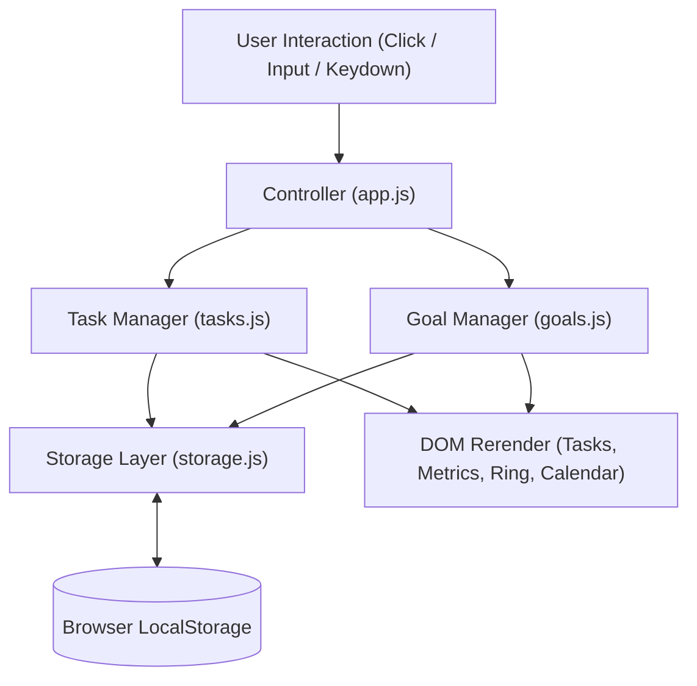

# FocusFlow — Personal Productivity Dashboard

> **PROJECT ASSIGNMENT 01**  
> **Developer:** Sameera Bhanu  
> **Academic Affiliation:** B.Tech in Computer Science & Engineering (First Year), [Shri Vishnu Engineering College for Women (SVECW)](https://www.linkedin.com/school/15124808/), Bhimavaram  
> **Technologies:** Semantic HTML5, Modern CSS3 (Grid & Flexbox), Vanilla JavaScript (ES6+)  
> **Storage:** Browser `localStorage`  
> **Live Deployment:** [https://sksameera321.github.io/personal-productivity-dashboard/](https://sksameera321.github.io/personal-productivity-dashboard/)  
> **GitHub Repository:** [https://github.com/sksameera321/personal-productivity-dashboard](https://github.com/sksameera321/personal-productivity-dashboard)

---

## 1. Project Objective & Vision

**FocusFlow** is a modern, responsive personal productivity application engineered specifically for university students and engineers to organize their daily academic work, manage high-priority tasks, set personal daily goals, and observe real-time productivity metrics.

Rather than assembling a static webpage or relying on heavyweight frontend frameworks, this project was developed from the ground up using **pure semantic HTML5, modern CSS3, and modular Vanilla JavaScript**. The primary engineering objective is mastering core DOM manipulation, event-driven state orchestration, and client-side data persistence before progressing to React.

---

## 2. Design System & Apple-Inspired Aesthetic

The visual architecture is guided by **Apple-like simplicity, quiet sophistication, and functional minimalism**:

- **Neutral Porcelain Palette**: Subtle off-white canvas (`#FBFBFD`) paired with elevated pure white cards (`#FFFFFF`) and hairline dividers (`#E5E5EA`).
- **Typography & Whitespace**: System font stack (`-apple-system, "SF Pro Text", "Inter"`) with generous margins (24px–32px) and calibrated leading to eliminate cognitive noise.
- **Intentional Color Accents**:
  - **Electric Blue (`#0071E3`)**: Primary actions, today's schedule indicator, and progress ring.
  - **Apple Green (`#34C759`)**: Completed items and success states.
  - **Amber (`#FF9F0A`)**: Medium priority focus.
  - **Coral Red (`#FF3B30`)**: High priority tasks and overdue alerts.
- **Restraint Over Clutter**: No unnecessary decorative cards, no loud gradients, and no gimmicky animations. Micro-interactions are smooth, responsive, and tactile (44px touch targets, custom circular checkboxes, and backdrop-blur modals).

---

## 3. Core Feature Specifications

### A. Dashboard Overview
- **Contextual Welcome Message**: Dynamically shifts between *"Good morning"*, *"Good afternoon"*, and *"Good evening, Sameera"* based on local clock hours.
- **Current Calendar Date**: Real-time formatted date string (e.g. *Monday, November 9, 2026*).
- **Productivity Summary Headline**: Context-aware summary alerting the user to today's active task load.
- **Live Metric Cards**:
  - **Total Tasks**: Aggregate task count.
  - **Completed Tasks**: Tasks marked done.
  - **Pending Tasks**: Active tasks requiring attention.
  - **Daily Progress Gauge**: Interactive SVG circular progress ring animating from `0%` to `100%`.

### B. Task Management
- **Task Creation**: Modal dialog capturing Title (required), Context/Description (optional), Due Date, and Priority.
- **Inline Editing**: Full edit capability for existing tasks with pre-populated form fields.
- **Safe Task Deletion**: Custom modal confirmation dialog to prevent accidental data loss.
- **Status Toggle**: Custom circular checkbox marking tasks completed/pending with instant visual feedback.
- **Priority Classification**: Color-coded badges for **High**, **Medium**, and **Low** priority.
- **Multi-Criteria Filtering**: Instant segment switching between **All**, **Pending**, and **Completed**.
- **Real-Time Title Search**: Non-blocking instantaneous filtering as the user types, with a single-click clear button.

### C. Daily Goals & Habit Tracker
- **Personal Goal Creation**: Inline quick-add form for daily habits and study targets.
- **Progress Tracking**: Real-time completion fraction (e.g. `2/3 Goals`) and animated progress bar.
- **Interactive Checkboxes**: Click or keyboard (`Enter`/`Space`) toggles goal completion.
- **Goal Deletion**: Instant deletion with automatic recalculation of daily progress.

### D. Interactive Weekly Schedule Strip
- **7-Day Rolling Calendar**: Automatically calculates Monday-to-Sunday for the active week.
- **Today's Highlight**: Distinct visual indicator marking the current date.
- **Task Activity Dots**: Visual dot indicators under dates showing whether tasks are scheduled for that day.
- **Day-Specific Filtering**: Clicking any day filters the main task list to display only tasks due on that selected date, accompanied by a clean dismissible filter banner and *"Show All Days"* action.

### E. Productivity Statistics & Insights
- **Completion Rate**: Calculated percentage dynamically updating the circular ring.
- **Priority Distribution Matrix**: Real-time counter of pending High, Medium, and Low priority items.
- **Smart Motivational Insights**: Contextual encouragement adapting whether the user is facing heavy high-priority items or has achieved a clean streak.

### F. Data Persistence (Browser LocalStorage)
- **Automatic Auto-Save**: Every task creation, edit, status toggle, goal addition, and deletion persists immediately.
- **Zero Data Loss on Refresh**: All data reloads reliably across browser reloads or restarts.
- **First-Run Seed Data**: Intelligently seeds realistic academic sample tasks on first launch so the interface is never an intimidating blank screen.

---

## 4. Application Architecture & Modular Design

```text
personal-productivity-dashboard/
├── index.html          # Semantic HTML5 markup, ARIA accessibility, modals
├── css/
│   └── style.css       # Apple-inspired CSS custom properties, grid & flexbox, responsive design
├── js/
│   ├── storage.js      # LocalStorage API wrapper, safe JSON parsing, sample data seeder
│   ├── tasks.js        # Task entity state, CRUD methods, priority sorting, filtering logic
│   ├── goals.js        # Daily goals model, completion statistics, persistence
│   └── app.js          # Controller orchestrating UI events, calendar strip, search, modals
├── assets/             # Vector icons & branding graphics
├── server.js           # Lightweight zero-dependency development server (port 3001)
├── README.md           # Technical documentation and assignment report
└── .gitignore          # Version control hygiene
```

### Data Flow Diagram



---

## 5. Engineering Challenges & Solutions

### Challenge 1: Smooth SVG Circular Progress Indicator Geometry
- **Problem**: Generating a smooth circular progress indicator in pure SVG without external charting libraries requires calculating stroke circumference and dynamic offsets. Without proper bounds checking, empty task lists caused `NaN%` or negative dash offsets.
- **Solution**: Engineered a circle element with radius `r = 23px`. The circumference was calculated via KaTeX math: $C = 2 \times \pi \times 23 \approx 144.51\text{px}$. The dynamic offset was derived using:
  $$\text{Offset} = C - \left(\frac{\text{Percentage}}{100} \times C\right)$$
  Added protective logic so when total tasks equal 0, percentage defaults safely to 0% and transitions with `stroke-dashoffset 0.6s cubic-bezier(0.4, 0, 0.2, 1)`.

### Challenge 2: Dynamic Weekly Calendar Strip & Month Boundary Alignment
- **Problem**: University students often work across week and month boundaries (e.g. week spanning Oct 29 to Nov 4). Hardcoded dates break immediately.
- **Solution**: Developed an algorithm in `app.js` that determines the current date, calculates the day of the week, shifts backward to Monday (`distanceToMonday = (dayOfWeek + 6) % 7`), and loops 7 days forward creating real `Date` instances. Each date is cross-referenced with `TaskManager.getByDate(dateString)` to count tasks and render active indicator dots.

### Challenge 3: Resilient LocalStorage Serialization & Safe Input Sanitization
- **Problem**: User input containing special characters (`<`, `>`, `&`, `"`) could break DOM rendering or trigger XSS vulnerabilities when updating titles. Additionally, corrupt or cleared `localStorage` could throw `JSON.parse` exceptions.
- **Solution**: Built a centralized `Storage.get(key, fallback)` wrapper with `try...catch` blocks returning safe default arrays. In `app.js`, implemented an `escapeHTML(str)` utility using browser `textContent` encoding before any dynamic innerHTML injection, guaranteeing security and data integrity.

---

## 6. Seven-Day Academic Development Plan

| Day | Milestone | Key Deliverables Completed |
|:---:|:---|:---|
| **Day 1** | Requirements & Wireframing | Synthesized assignment objectives, studied Apple human interface guidelines, and planned 2-column layout. |
| **Day 2** | Semantic HTML5 Foundation | Built `index.html` structure: top app bar, hero, metrics cards, weekly strip, task feed, and accessible modals. |
| **Day 3** | CSS3 Styling & Responsiveness | Engineered `style.css` design system: typography, custom rounded checkboxes, priority chips, mobile breakpoints. |
| **Day 4** | Task Management Engine | Implemented `tasks.js`: task model, CRUD operations, priority sorting, status toggling, and search filtering. |
| **Day 5** | Daily Goals & Weekly Schedule | Implemented `goals.js` and `app.js` calendar generator with dynamic day selection and circular SVG meter. |
| **Day 6** | LocalStorage Persistence & Testing | Built `storage.js`, tested edge cases (empty states, overdue dates, quota limits), and refined micro-interactions. |
| **Day 7** | Deployment & Documentation | Created `server.js`, authored comprehensive `README.md`, committed to GitHub, and launched live GitHub Pages. |

---

## 7. Local Development & Testing Instructions

To run and inspect the project locally on your machine:

```bash
# 1. Navigate to the project directory
cd E:\sameera-projects\personal-productivity-dashboard

# 2. Start the lightweight zero-dependency server
node server.js
```

Open your browser to:
**`http://localhost:3001`**

---

## 8. Final Submission Checklist

- [x] **Semantic HTML5**: Validated document structure with accessible ARIA landmarks.
- [x] **Modern CSS3**: Flexbox & CSS Grid, Apple-inspired porcelain palette, no external UI frameworks.
- [x] **Vanilla JavaScript**: Modular code (`storage.js`, `tasks.js`, `goals.js`, `app.js`), zero framework dependencies.
- [x] **LocalStorage Persistence**: Auto-save on every state change, seamless page refresh survival.
- [x] **Responsive Design**: Flawless layout on desktop, laptop, tablet, and mobile screens.
- [x] **Error Handling**: Empty states, invalid inputs, and delete confirmation safeguards.
- [x] **Live GitHub Pages Deployment**: Fully deployed and verified accessible worldwide.

---

<sub>FocusFlow &bull; Engineered with craftsmanship by **Sameera Bhanu** &bull; &copy; 2026</sub>
