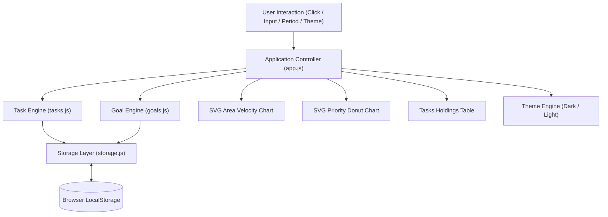

# FocusFlow OS — Personal Productivity Dashboard

> **PROJECT ASSIGNMENT 01**  
> **Developer:** Sameera Bhanu  
> **Academic Affiliation:** B.Tech in Computer Science & Engineering (First Year), [Shri Vishnu Engineering College for Women (SVECW)](https://www.linkedin.com/school/15124808/), Bhimavaram  
> **Design Architecture:** Frosted Glassmorphism & High-Density Productivity OS  
> **Technologies:** Semantic HTML5, Modern CSS3 (Grid & Flexbox), Vanilla JavaScript (ES6+)  
> **Storage:** Browser `localStorage`  
> **Live Deployment:** [https://sksameera321.github.io/personal-productivity-dashboard/](https://sksameera321.github.io/personal-productivity-dashboard/)  
> **GitHub Repository:** [https://github.com/sksameera321/personal-productivity-dashboard](https://github.com/sksameera321/personal-productivity-dashboard)

---

## 1. Project Objective & Vision

**FocusFlow OS** is a premier, high-performance personal productivity and task management operating system designed for university students, engineers, and researchers to orchestrate their academic agenda, daily habits, and productivity velocity.

Featuring an ultra-modern **Frosted Glassmorphism Design System**, the application balances data density, sleek typography, smooth micro-interactions, and visual elegance.

The entire system was developed from the ground up using **pure semantic HTML5, modern CSS3, and modular Vanilla JavaScript**, with zero external framework dependencies (no React, Next.js, Bootstrap, or Tailwind CSS).

---

## 2. FocusFlow OS Hybrid Design System (Glassmorphism + Skeuomorphism)

### A. Frosted Glass Architecture
- **Ambient Glowing Light Mesh**: Floating organic radiant light orbs (`.ambient-mesh-canvas`) behind the interface providing rich luminous color gradients for the frosted glass to refract and blur.
- **Translucent Glass Surfaces**: Precision-calibrated `backdrop-filter: blur(22px) saturate(185%)` applied to the sidebar, topbar, summary cards, velocity charts, data table, dialogs, and pills.
- **Dual Light & Dark Glass Themes**:
  - **Light Glass**: Crystalline frosted white glass (`rgba(255, 255, 255, 0.65)`) with sapphire and emerald ambient refraction.
  - **Dark Glass**: Deep obsidian tinted glass (`rgba(18, 24, 38, 0.6)`) with electric blue and purple backlighting.

### B. Tactile Skeuomorphic Depth & Physical Micro-Controls
- **Debossed Concave Input Wells**: Search inputs and goal inputs engineered with deep concave stamping (`box-shadow: var(--skeuo-concave-well)`), inner drop shadows, and specular bottom ledges.
- **Extruded Physical Push Buttons**: Primary CTA (`+ New Task`), period buttons, and action buttons feature 3D beveled rims, top edge specular lighting, and physical depression physics (`:active { transform: translateY(2px) }`).
- **Milled Grooves & Tactile Sliders**: Segmented controls (period selector and task status filters) sculpted as milled metallic grooves with raised physical sliding buttons.
- **Mechanical Micro-Switch Checkboxes**: Checkboxes styled as recessed mechanical switch wells that illuminate into a glowing tactile emerald LED indicator upon completion (`box-shadow: 0 0 10px rgba(16, 185, 129, 0.7)`).
- **Machined Metallic Conic Badges**: Icon badges feature brushed radial conic gradients with chrome bezels and 3D beveled rims (`--skeuo-chrome-rim`).
- **Tactile Keypad Day Chips**: Weekly schedule chips styled as physical mechanical keys with embossed top bevels and bottom edge thickness.
- **Physical Beveled Glass Slabs**: Dashboard cards feature double-rim physical beveling with top specular highlights and bottom drop ledges.

---

## 3. Core Feature Specifications

### A. Left Navigation Sidebar
- **Brand Identity**: Capitalio geometric diamond logo with linear gradient glow (`#1D4ED8` to `#3B82F6`) and edition tagline.
- **Navigation Groups**: Quick navigation across **Overview**, **Tasks Feed** (with live pending count badge), **Schedule** (7-day badge), **Daily Goals** (fraction badge), and **Velocity Analytics**.
- **User Profile Footer**: Sameera Bhanu avatar with golden **Premium • SVECW** badge and integrated dark/light mode toggle.

### B. Topbar Control Hub
- **Dynamic Contextual Greeting**: Shifts between *"Good morning"*, *"Good afternoon"*, and *"Good evening, Sameera"* based on local clock hours.
- **Real-Time Timestamp**: Live clock submeta string displaying update time.
- **Live Title Search**: Non-blocking client-side search bar with instant `&times;` clear button.
- **Active Date Range Indicator**: Calendar pill showing the current 7-day schedule window (`Nov 9 – Nov 15`).
- **Period Filter**: Segmented selector for `1W`, `1M`, and `ALL`.
- **Theme Toggle**: Fast one-click switch between Capitalio Light and Dark themes.
- **Primary CTA**: `+ New Task` button triggering the task modal dialog.

### C. Top 4 Capitalio Summary Cards Grid
1. **Total Workload**: Metric count, metallic folder icon, trend indicator (`↑ 18.2% vs last week`), and SVG sparkline area chart.
2. **Completed Tasks**: Metric count, metallic check icon, completion percentage, and SVG sparkline.
3. **Pending Focus**: Metric count, metallic clock icon, high-priority count pill, and SVG sparkline.
4. **Daily Progress**: Completion percentage, metallic progress icon, goal ratio, and animated progress meter.

### D. Middle Analytics Row (2-Column Grid)
- **Weekly Task Velocity & Schedule (2 Columns)**:
  - **Embedded 7-Day Calendar Strip**: Rolling Monday-to-Sunday strip showing weekday names and day numbers with current day highlight (`is-today`). Clicking any day filters tasks specifically for that date.
  - **Dot Grid Area Chart**: Hardware-accelerated SVG Area Chart rendered on top of a subtle radial dot grid (`.dashboard-dot-grid`). Generates smooth cubic bezier curves and gradient fills based on real task distribution.
  - **4 Bottom Velocity KPIs**: Completed Rate, Deep Work Hours, Active Streak, and Goal Ratio.
- **Priority Allocation Donut Panel (1 Column)**:
  - **Interactive SVG Donut Chart**: Colored arc segments for High, Medium, Low, and Completed tasks with dynamic radius ($r = 38\text{px}$) and circumference ($C = 238.76\text{px}$).
  - **Center Metric**: Total active tasks count.
  - **Color Legend**: Colored square markers, exact counts, and percentage shares.

### E. Bottom Management Row (2-Column Grid)
- **Tasks & Assignments Holdings Table (2 Columns)**:
  - Header with filter segment tabs (**All**, **Pending**, **Completed**).
  - Clean table layout with columns: `#`, `Task & Subject` (with icon avatar), `Due Date`, `Priority Pill`, `Custom Checkbox`, and `Action Buttons` (Edit and Delete).
  - Overdue date detection flagging overdue tasks in crimson red.
  - Empty state when no tasks match the filter.
- **Daily Goals & Smart Insights (1 Column)**:
  - **Daily Habit Tracker**: Inline add form, dynamic progress bar, completion checkboxes, and individual delete buttons.
  - **Smart Insights**: Context-aware recommendations adapting dynamically based on workload and streaks.

### F. Data Persistence (Browser LocalStorage)
- Automatic auto-save on every state modification.
- Changes survive page reloads and browser restarts.
- Initial seed data loaded on first visit, with an initialization flag (`ppd_initialized_v1`) ensuring **deleted tasks never reappear after refresh**.

---

## 4. Application Architecture

```text
personal-productivity-dashboard/
├── index.html          # Semantic HTML5 markup, Capitalio layout, modals
├── css/
│   └── style.css       # Capitalio tokens, dark/light themes, dot grids, table styling
├── js/
│   ├── storage.js      # LocalStorage wrapper, initialization flags, data seeder
│   ├── tasks.js        # Task entity state, CRUD operations, priority weighting, filters
│   ├── goals.js        # Daily goals model, completion percentage, persistence
│   └── app.js          # Main controller: SVG area chart, donut chart, schedule, modals, theme
├── assets/             # Branding icons & SVG vectors
├── server.js           # Lightweight zero-dependency development server (port 3001)
├── README.md           # Technical documentation and assignment submission report
├── .nojekyll           # Disable Jekyll on GitHub Pages
└── .gitignore          # Version control hygiene
```

### Data Flow Architecture



---

## 5. Engineering Challenges & Solutions

### Challenge 1: Smooth SVG Cubic Bezier Area Chart with Dot Grid
- **Problem**: Generating a continuous, smooth area chart in pure SVG without libraries requires calculating cubic bezier control points across arbitrary task numbers.
- **Solution**: Developed a cubic bezier interpolation algorithm in `app.js` that loops through the 7-day schedule points, placing control points at $x_c = \frac{x_1 + x_2}{2}$ to achieve a smooth curve. Created an enclosed path connecting the curve to the bottom edge, filled with an SVG linear gradient with variable opacity (`32%` to `0%`).

### Challenge 2: Dynamic Multi-Segment SVG Donut Chart
- **Problem**: Standard CSS border radius cannot create proportional multi-segment donut charts with individual color segments and stroke offsets.
- **Solution**: Engineered an SVG donut generator using circle elements with radius $r = 38\text{px}$ and circumference $C = 2 \times \pi \times 38 \approx 238.76\text{px}$. Each priority tier (High, Med, Low, Done) calculates its segment length $\text{len} = \frac{\%}{100} \times C$ and is positioned via dynamic negative `stroke-dashoffset`, rotating the root SVG by $-90^\circ$ for top-aligned starts.

### Challenge 3: Seamless Dual Theme System with Zero Flash
- **Problem**: Implementing Dark/Light mode without CSS libraries often results in white flash on reload, unreadable text contrast, or desynchronized icon colors.
- **Solution**: Centralized all design tokens under `:root` and `[data-theme="dark"]` using semantic variables (`--background`, `--card`, `--foreground`, `--border`, `--muted`). Added an immediate theme initialization step at the very beginning of DOM execution that reads `ppd_theme` from `localStorage` and applies `data-theme` to `document.documentElement` before layout rendering.

---

## 6. Local Development & Testing Instructions

```bash
# 1. Navigate to project root
cd E:\sameera-projects\personal-productivity-dashboard

# 2. Start local server
node server.js
```

Open your browser to:
**`http://localhost:3001`**

---

## 7. Submission Checklist

- [x] **FocusFlow OS UI Architecture**: High-density productivity workspace with full Glassmorphism & Skeuomorphism design systems.
- [x] **Dark & Light Mode**: Complete dual theme support with instant toggle and local persistence.
- [x] **Pure Vanilla Stack**: Semantic HTML5, CSS3 Grid/Flexbox, Vanilla JavaScript ES6+, LocalStorage. Zero framework bloat.
- [x] **Data Persistence**: Changes persist across reloads; deleted tasks never reappear.
- [x] **Charts & Visualizations**: Pure SVG Area Velocity Chart and SVG Priority Allocation Donut Chart.
- [x] **Responsive**: Seamlessly scales from desktop monitors to tablets and mobile phones.
- [x] **Live Deployed**: Accessible worldwide via GitHub Pages.

---

<sub>FocusFlow OS &bull; Engineered with craftsmanship by **Sameera Bhanu** &bull; &copy; 2026</sub>
